# Enclosure

A parametric build123d case for the Hosyond ES3C35P board and the 66 × 35.5 × 19.7 mm battery + speaker pack, printed in PETG on a Bambu Lab P2S. It prints in two colours: black for the case and white for the labels.

**Outside size:** 64 W × 112 H × 33.7 D mm (the stand adds a 68.6 × 60.1 mm footprint).

**Features:**
- The glass sits flush with the front, inside a 45° bevelled edge. A white **USB-C ▼** label is inlaid below the screen.
- A **hinged door** in the back opens onto the BOOT and RESET buttons. It prints in place with the cover and clicks shut. Its inside face carries white **BOOT** and **RESET** labels lined up with the buttons.
- A thin printed **wafer** sits between the back of the board and the battery pack.
- **Snap tabs** hold the cover on: press it into the shell until it clicks, no tools. Two pry notches at the seam let you pop it off again. The four screws are now optional.

| 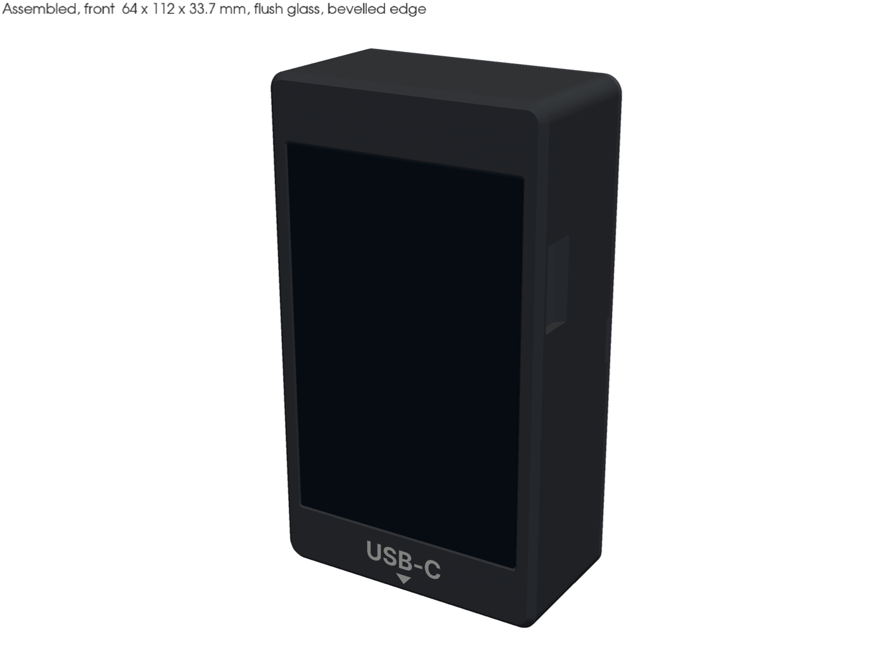 | 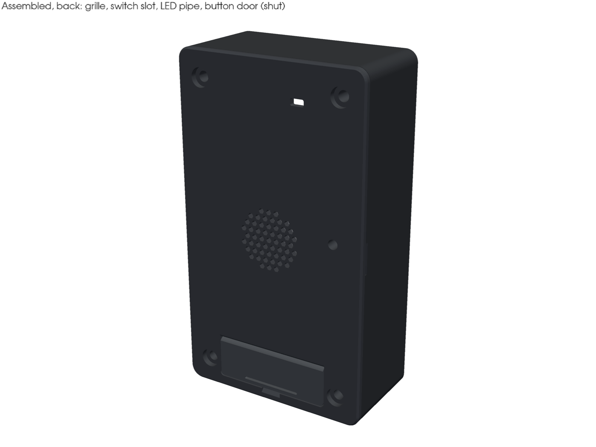 |
|---|---|
| 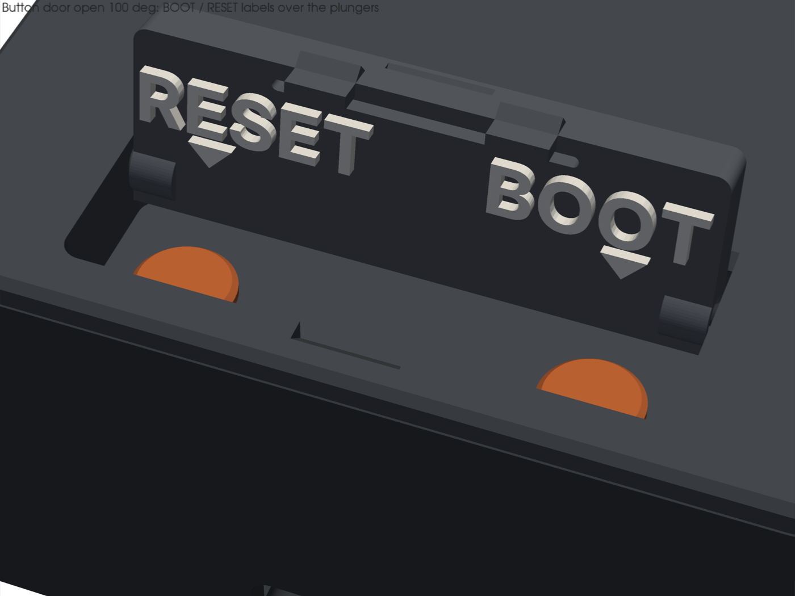 | 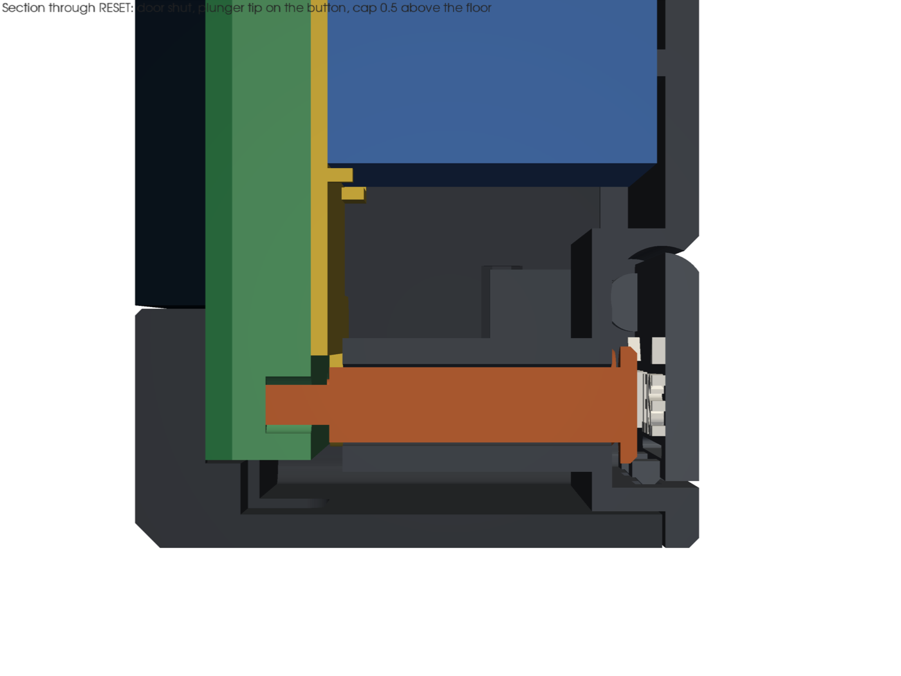 |
| 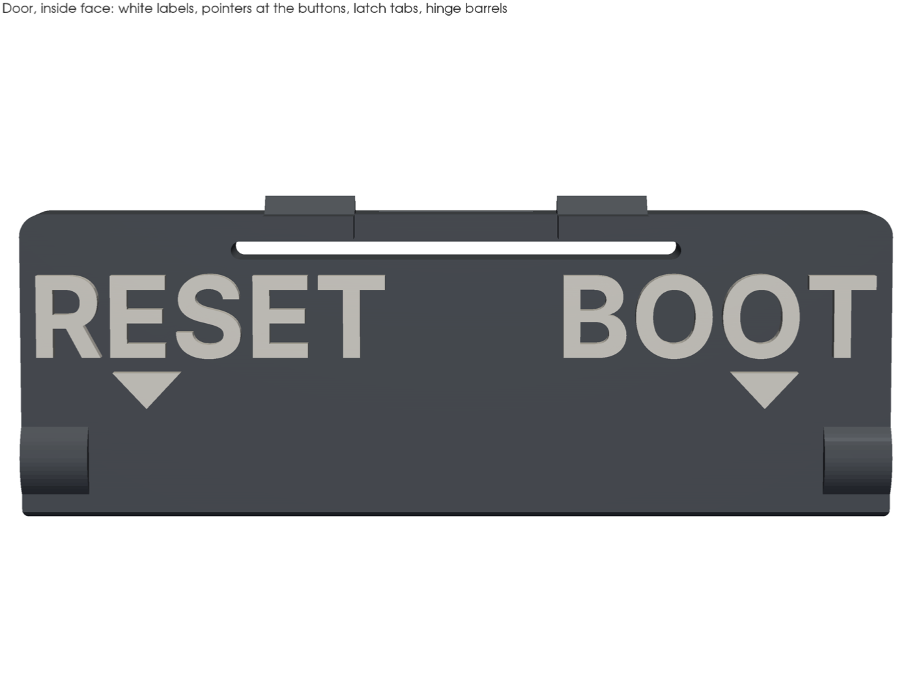 | 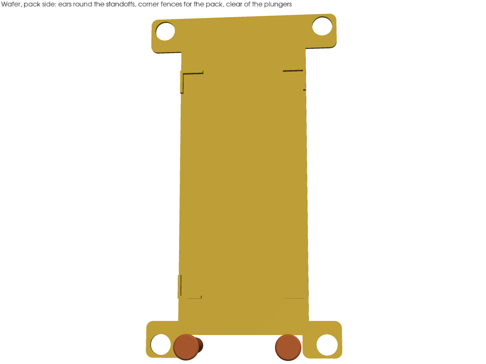 |
| 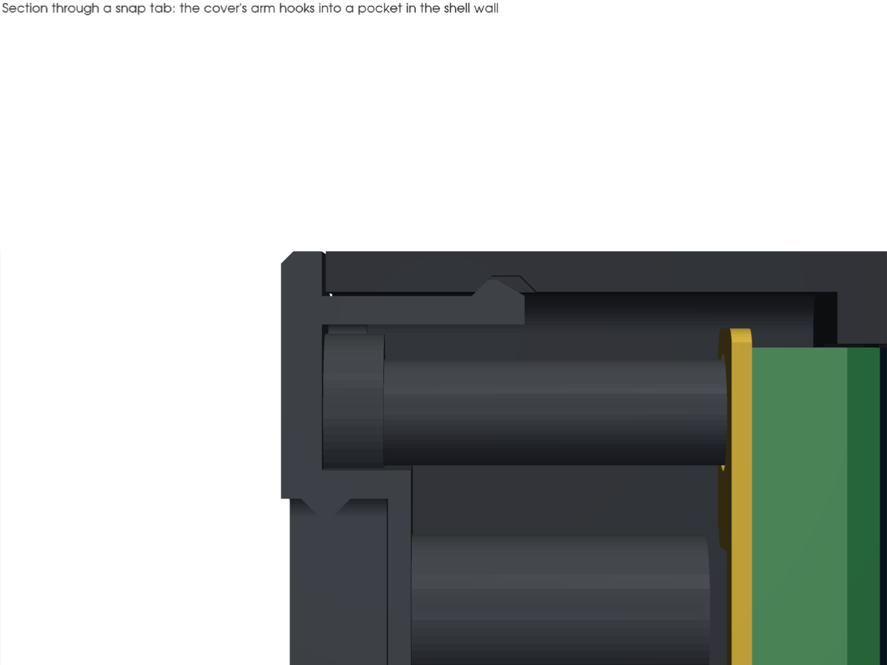 | 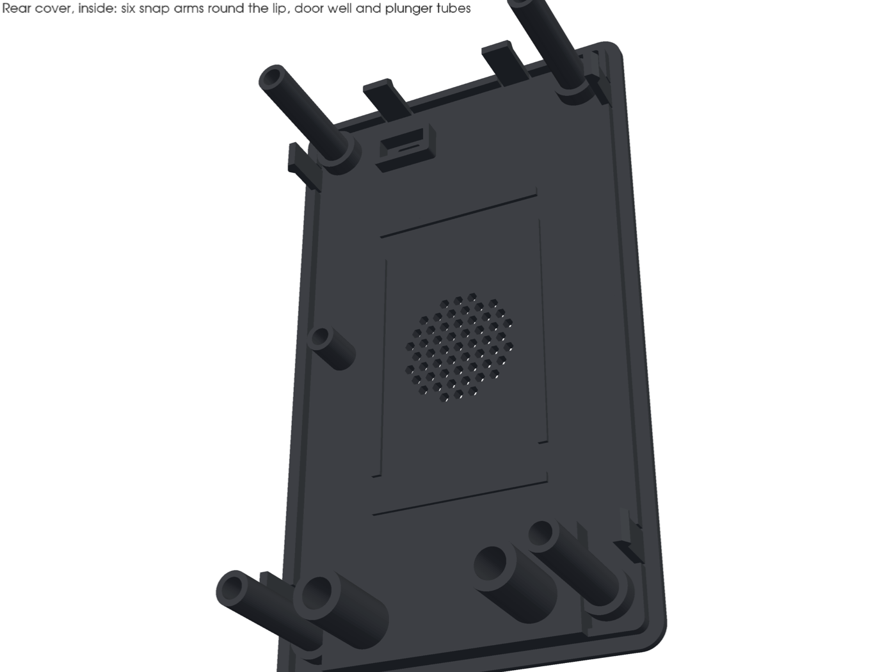 |
| 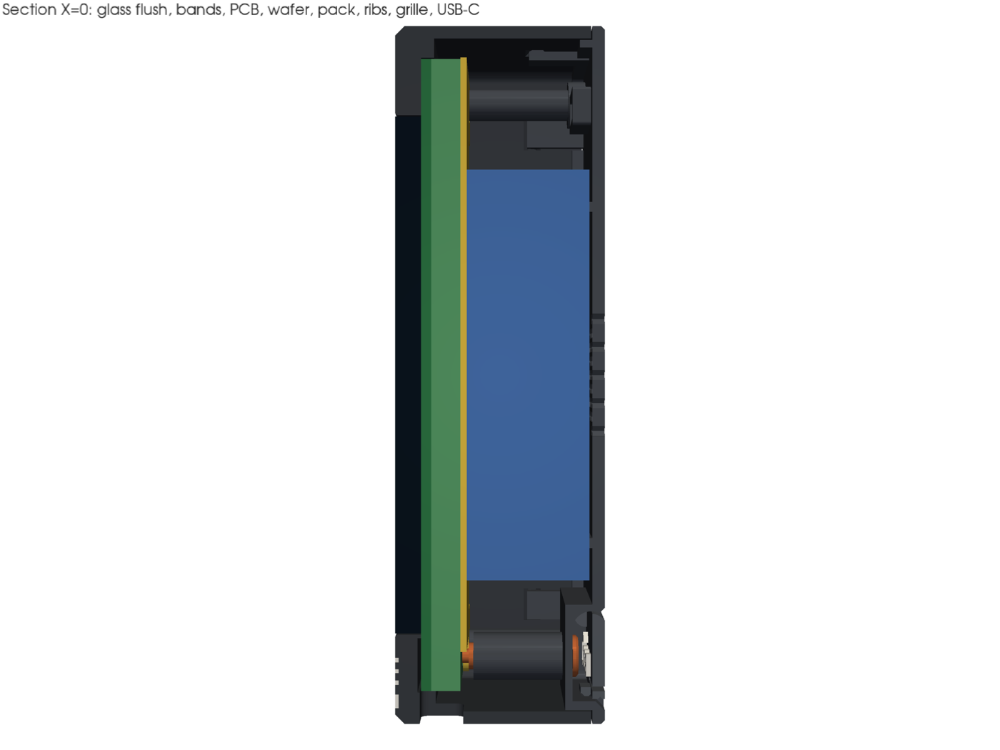 | 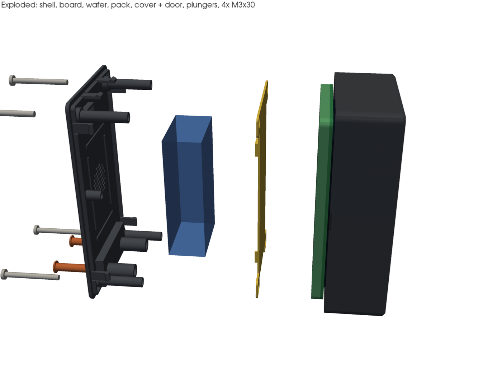 |
| 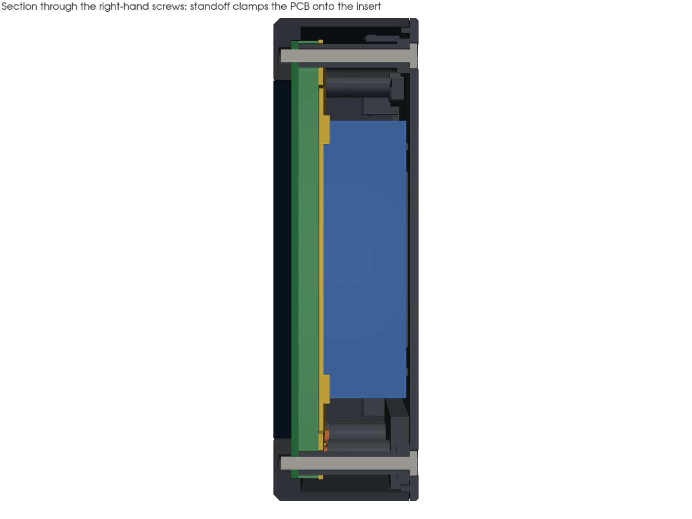 | 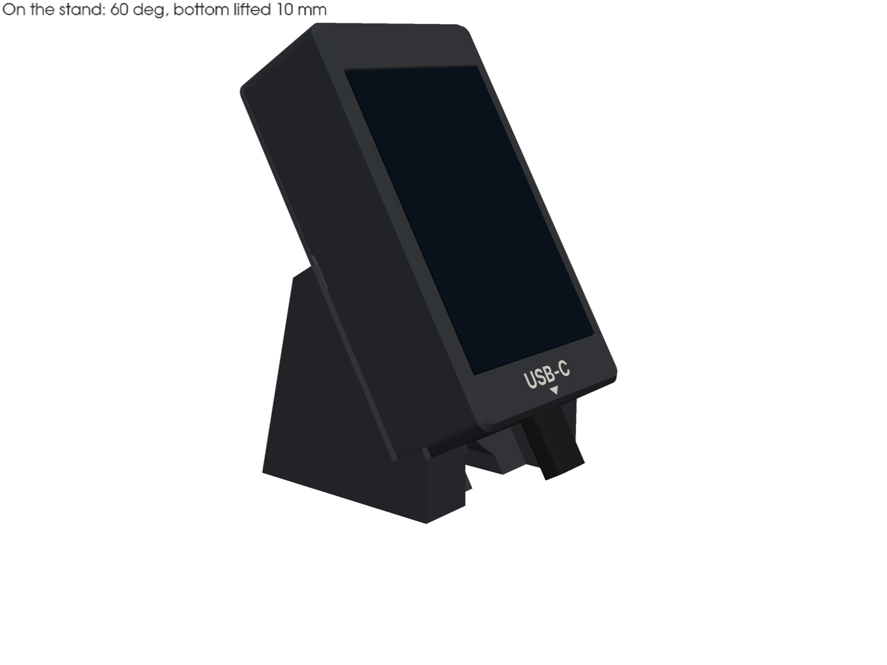 |

## Files

| Path | What it is |
|---|---|
| `params.py` | Every dimension. Each one is tagged `[drawing]`, `[plan]`, `[assumed]` (measure it) or `[design]` |
| `parts/front_shell.py` | Flush glass window, bevelled front edge, board pocket, locating bands with 4 insert holes, walls, USB-C and microSD openings, USB-C label inlay, snap pockets and pry notches |
| `parts/rear_cover.py` | Back plate, locating lip, 4 clamp standoffs, pack ribs, speaker grille, switch slot and cradle, LED light-pipe tube, six snap arms, and the door well: cone hinge pins, latch grooves, nail notch, plunger guide tubes |
| `parts/door.py` | The button door (prints in place in the cover) and its BOOT / RESET labels |
| `parts/plunger.py` | Button plunger (print 2) |
| `parts/wafer.py` | Wafer between the board's rear parts and the pack |
| `parts/snaps.py` | Snap arms (on the cover), their wall pockets and the pry notches (in the shell) |
| `parts/stand.py` | Detachable 60° desk stand |
| `parts/fit_coupon.py` | The first 6.8 mm of the front shell, for a fit test |
| `parts/door_test.py` | The bottom of the cover with the door, for a hinge and latch test |
| `parts/refs.py` | Simple boxes for the board, buttons, pack, USB plug and cable channels (validation and previews only) |
| `fonts/` | Inter Bold, used for the labels (SIL Open Font License, see `fonts/OFL.txt`) |
| `build.py` | Writes `out/<part>.stl`, `.3mf` and `.step` in print orientation, plus `out/assembly.step`. Two-colour parts also get `out/<part>_text.stl` (see Printing) |
| `validate.py` | 122 checks (see below), then renders `out/previews/*.png` |

## Setup

build123d needs the OCP (OpenCascade) wheels, which don't support the system Python 3.14 yet. Use a Python 3.13 (or 3.12) venv:

```bash
python3.13 -m venv enclosure/.venv
```

```bash
enclosure/.venv/bin/pip install -r enclosure/requirements.txt
```

On macOS, Homebrew's `python@3.13` provides `python3.13`. `uv venv -p 3.13 enclosure/.venv` works too. The venv is git-ignored.

## Build and check

```bash
enclosure/.venv/bin/python enclosure/build.py
```

```bash
enclosure/.venv/bin/python enclosure/validate.py
```

On a headless Linux box the previews need a virtual display: run validation under `xvfb-run -a`.

The build takes about 15 s. Validation takes about 20 s, plus about 25 s for the previews; add `--no-previews` to skip them. Validation exits non-zero if any check fails. It checks:

- **Solids.** Every part is one valid solid (the label bodies are one solid per letter).
- **Build volume.** Every part fits the 256 mm build volume, lying flat on the plate in its print orientation.
- **Interference.** No printed part overlaps the glass, PCB, rear-parts envelope or pack, or another printed part. The wafer is rigid, so the ribs' 0.2 mm preload is taken by the cover plate flexing back. The pack is checked against the cover moved back by that much.
- **Clearances and contacts.**
  - Glass-to-window gap: 0.2 mm.
  - PCB-to-pocket gap: 0.2 mm.
  - The PCB touches the bands, the standoffs touch the PCB pads, the wafer rests on the rear parts, the pack rests on the wafer, and the ribs touch the pack.
  - The board can slide in from the back.
  - The front bevel leaves a flat strip beside the glass.
- **Fasteners.** Front skin in front of the inserts, screw tip depth, thread engagement and head recess.
- **Ports and cable space.** The USB-C overmold and the microSD path are clear, and the left and right cable channels are free.
- **Snap tabs.**
  - The hooks sit on their pocket faces without overlapping the shell.
  - Each arm has room to flex inward, and bends at under 2% strain.
  - The hooks reach 0.6 mm into the wall, which keeps 1.2 mm behind each pocket.
  - The arms clear the pack, wafer, board, door and cable runs.
- **Button door.**
  - Shut, the door doesn't touch the cover, and every print-in-place gap is at least 0.3 mm.
  - The door's outside face is flush with the back.
  - The cone pins reach 0.6 mm into the door, so it can't come off.
  - Swung out in steps to 100°, the door clears the cover. It actually opens to about 108°.
  - The latch ridges engage 0.4 mm, and the strip bends at under 2% strain.
  - The labels sit on the door, and each pointer is at its button's exact X.
- **Plungers.** They fit their tubes, rest on the buttons, and clear the wafer and the shut door. They also have enough stroke to click the buttons, and can't leave their tubes while the door is shut.
- **White text.** The USB-C inlay is flush and fills its pocket. It sits on the flat band below the screen. All white parts are at least 3 layers thick.
- **Stand.** The device rests on the stand without overlap, its bottom is 8–12 mm up, and the USB-C plug clears both the stand and the counter.

## Design notes

- **Datum and flushness.**
  - The glass is exactly as wide as the PCB, so the PCB front face bears on two solid bands over the 9.25 mm strips above and below the glass, `GLASS_TO_PCB` (4.2 mm) behind the case face.
  - The window is the glass outline plus `GLASS_GAP` (0.2 mm) per side, with a 0.4 mm chamfer at the face.
  - `GLASS_FLUSH` lets the glass stand slightly proud if a print comes out recessed.
  - Nothing stands above the glass, so a finger slides straight off the screen onto the frame.
  - The outside edge of the front face has a 1.5 mm, 45° bevel (`FRONT_BEVEL`). That leaves a 3 mm flat strip beside the glass. A 45° bevel prints cleanly face down; a shallower slope would hang in the air and need supports.
- **Snap tabs (toolless).**
  - Six arms on the cover reach 10 mm forward along the inside of the shell walls: two on each side wall and two on the top wall. The door block fills the bottom wall, so it has none. Each arm is 5 × 1.4 mm. Its hook clicks into a blind pocket in the wall, so nothing shows on the outside.
  - Each hook has a shallow lead-in ramp, so the cover presses on easily. Its back face is 45°, so it prints without supports and lets go to a firm pull. To open, put a thumbnail or coin in a pry notch at the seam halfway up each side and lever the cover off. Work round both sides.
  - Snapped on, the cover sits where the screws used to pull it. The standoffs rest on the PCB pads and hold the board on the bands, and the ribs press the pack.
  - The arms are placed clear of the screw posts, the cable runs, the switch and the door.
- **Optional screws.** The screw holes and insert holes stay in the model. For a case that gets carried around or dropped, fit four **M3 × 30 button-head** screws through the rear cover's standoffs and the PCB holes into **M3 × 3 mm heat-set inserts** in the front bands. Otherwise skip the inserts and screws.
  - The standoffs (Ø5.4) bear only on the Ø5.6 pad rings and press the PCB onto the bands.
  - The cover stops 0.2 mm short of the shell rim (`SEAM_GAP`), so the screws always clamp the board rather than the seam.
  - The ribs also push the pack and wafer against the board, so the board stays seated even with the cover off.
- **Why this differs from PLAN.md §9.**
  - The plan had separate board screws (M3 × 8) and rear-cover screws. The bands are only 4.2 mm thick, so an insert can be at most 3 mm long to keep 1.2 mm of front skin. An M3 × 8 would come out through the front face.
  - Separate rear-cover bosses would have to sit outside the board outline, and at 64 mm wide the corners only leave about 1.3 mm of wall around a Ø4 insert.
  - Through-bolting avoids both problems and cuts the fastener list to 4 inserts and 4 screws.
- **Button door.**
  - **Why it's in the back.** BOOT and RESET are on the back of the board, 3.3 mm from the USB-C edge. Only a door in the back cover, right over that end, can reach them; a door in the top end of the case would be 100 mm away. The door sits at the bottom of the back, between the two lower screws. The hinge runs along its upper edge, so its lower edge (nearest the USB-C) lifts out.
  - **Printed in place.** The door prints in its opening, with the cover, outside face down. There's a 0.4 mm gap all round it (`DOOR_GAP`). It hinges on two 45° cone pins that stick out of the well's side walls into sockets in the door's end barrels, with a 0.35 mm gap (`HINGE_GAP`). The cones and sockets print without supports, and the door can't come off.
  - **Opening.** The door's outside face is flush with the back. The hinge axis is 2.2 mm in from the back, and a 45° chamfer on the cover's edge lets the door swing to about 108°. Past vertical, it stays open when the device lies face down.
  - **Latch.** A 0.8 mm through-slot behind the door's free edge lets the edge strip flex. Two tabs on the strip carry 45° ridges that click into matching grooves in the well wall, engaging 0.4 mm. A fingernail notch in the cover and a small V-groove in the door edge pull it open.
  - **Plungers.** The buttons sit about 26 mm in from the back face, too deep for a finger. So the well has a floor 5.2 mm in, with two Ø4.5 printed plungers in guide tubes that reach down to the buttons. Each plunger's cap is wider than its hole, so it can't fall into the case. At rest the tip sits on the button and the cap is 0.5 mm above the floor. Pressing the cap down to the floor clicks the button, and the floor stops it before it can over-press. With the door shut, the plungers are trapped. With the door open, don't turn the device back-down, or they can drop out.
  - **Labels.** **BOOT** and **RESET** stand 0.8 mm proud of the door's inside face in white, in Inter Bold with 3.75 mm capitals. The door is only 38.8 mm wide, so each word is moved inward just enough to fit: BOOT by 2.0 mm, RESET by 2.9 mm. A white triangle under each word sits at its button's exact position. With the door open, each triangle points down at its plunger. Shut, the labels sit over the plunger caps with 0.9 mm to spare.
  - **On the stand,** the door is flush, so it rests on the stand's backrest like the rest of the back. Lift the device off the stand to use the buttons.
- **Wafer.**
  - A 1.0 mm printed plate between the board's rear parts and the pack. It replaces the stick-on insulating pad from the plan.
  - Its four ears fit round the standoffs, so the cover locates it. Corner fences, 1.5 mm tall, hold the pack's corners with a 0.3 mm gap.
  - It stops short of the plungers at the bottom end and stays clear of the side cable runs.
  - PETG is a good insulator and handles the board's charging heat (up to 62 °C).
  - A printed wafer doesn't squash like foam, so the rib preload drops from 0.3 to 0.2 mm, and the cover plate flexes to take it. If the pack still rattles, add a strip of thin foam tape on the pack's back face.
- **Inside.**
  - The pack is centred on the board (`PACK_CY = 0`), leaving 17.75 mm free above and below it.
  - Each side has a cable channel for the battery lead (left socket) and the speaker lead (right socket).
  - The switch sits top-left (seen from the front), away from the stand.
- **Speaker grille.** 55 hexagonal holes (1.6 mm across flats, 1.0 mm webs) in a Ø22 circle. It's centred on the pack until you measure the speaker; then set `GRILLE_CX`, `GRILLE_CY` and `GRILLE_D`. The ribs keep a ring clear around the grille for a foam gasket.
- **Stand.**
  - Two wedge cheeks with side fences, joined by a cross bar.
  - The middle is open: the USB-C plug hangs from the bottom face, and the cable runs back along the counter through the pointed notch in the bar.
  - `STAND_ANGLE` and `STAND_LIFT` are parameters.

## Printing (PETG, Bambu Lab P2S, 0.4 mm nozzle, two colours)

Load **black PETG in AMS slot 1** and **white PETG in slot 2**.

**Two-colour parts.** The front shell, rear cover, fit coupon and door test each come as a pair of STLs in the same frame: `<part>.stl` (black) and `<part>_text.stl` (white). To set one up in Bambu Studio:

1. Drag **both files in together**. When Bambu Studio asks whether to load them as a single object with multiple parts, choose **Yes**.
2. In the Objects list, select the `_text` part and set its filament to **2 (white)**. Leave the rest on 1 (black).
3. Bambu Studio adds a prime tower. White only appears in a few layers, so the colour changes are few:
   - Front shell: the first 3 layers (0.6 mm) of the face-down front. The label is flush.
   - Rear cover: 4 layers (z = 2.0–2.8 mm), on the door's inside face. The labels stand proud.

`rear_cover.stl` holds two bodies: the cover and the door printed in place inside it. Keep them together. The `.3mf` files hold the same bodies as separate objects. If Bambu Studio splits them apart, use the STLs instead.

Start from Bambu Studio's **Generic PETG** (or your brand's) profile on the **textured PEI** plate, then change:

| Setting | Value |
|---|---|
| Layer height | 0.20 mm (0.16 mm for the front shell if you want finer side walls) |
| Wall loops | 5 (makes the 2.0 mm walls solid) |
| Top / bottom shell layers | 5 / 5 |
| Infill | 20% gyroid. The stand can use 15% |
| Nozzle / bed | 240–250 °C / 70–80 °C |
| Part cooling fan | 30–50%, and up to 80% for the cover's standoffs |
| Supports | **Off** for every part |
| Elephant foot compensation | 0.15 mm (needed for the print-in-place door) |
| X-Y hole compensation | 0, then tune from the coupon |
| Brim | None (the stand can take a 3 mm brim if it lifts) |

| Part | Orientation (as exported) | Notes |
|---|---|---|
| `fit_coupon` (+ `_text`) | Face down | About 14 cm³; roughly 25–30 min. Print it first |
| `door_test` (+ `_text`) | Outside face down | 48 × 21 × 6 mm. The bottom of the cover with the door; print it before the cover (see Assembly) |
| `front_shell` (+ `_text`) | **Face down** on the plate | Flat, textured front with the white USB-C label in the first layers. The USB-C top is a 12.5 mm bridge; everything else is vertical or 45° |
| `rear_cover` (+ `_text`) | Outside face down | The door prints in place. Standoffs, tubes, snap arms and ribs point up. Counterbores are on the plate side. The well floor is a 13 mm bridge over the door |
| `plunger` | Cap down | **Print 2.** Small and tall (22 mm); put them on the same plate as a bigger part so the layers have time to cool, and add a 3 mm brim |
| `wafer` | Board side down | 1.0 mm plate, fences up |
| `stand` | Upright, base down | The backrest leans at 30° from vertical. The cable notch has a 45° pointed top |

All parts fit on one plate together.

**Print-in-place door.** It needs the 0.15 mm elephant-foot compensation, so the door's first layer doesn't fuse to the cover's. When the cover comes off the plate, free the door gently: push it out from inside the well with a finger, then work it open and shut a few times. If it won't free up, raise `DOOR_GAP`, `HINGE_GAP` and `LATCH_GAP` by 0.05–0.1 mm and reprint the door test.

**Heat-set inserts.** Install them with a soldering iron at about **225 °C** (PETG; follow your insert maker's chart). Rest the shell face down on a flat, hard surface so the 1.2 mm front skin is supported. Press straight down slowly and stop when the insert is flush with the band face. Don't push past flush: the hole is blind, with only 1.2 mm of skin left. Let it cool before fitting the screws.

## Assembly order

1. **Fit coupon.** Print it (with its white text), then check four things:
   - Glass and window: the board's glass slides into the window with an even gap.
   - Pocket: the PCB drops into the pocket without force.
   - Flushness: lay a straightedge across the glass and frame. The glass should be flush to 0.1 mm proud.
   - Inserts: one insert installs cleanly.

   You can clamp the board to the coupon with M3 × 4 screws to check flushness under load. Adjust `GLASS_GAP`, `BOARD_GAP` or `GLASS_TO_PCB` / `GLASS_FLUSH` in `params.py`, then rebuild.
2. **Door test.** Print `door_test` (with its white text). Check three things:
   - The door frees up and swings past vertical.
   - The latch clicks shut and holds, and the fingernail notch opens it.
   - The labels are crisp and white.

   If the door sticks, raise the gaps (see Printing). If the latch is too stiff or too loose, change `LATCH_RIDGE` by ±0.1 mm.
3. **Print** the front shell, rear cover, 2 plungers, wafer and stand.
4. **Inserts (optional).** Only if you'll use the screws: install the 4 inserts in the front bands.
5. **Wiring.**
   - Solder the slide switch in series with the battery **+** lead.
   - Fit the 1.25 mm plugs (adapter or re-crimp).
   - **Check polarity with a meter** against the board's BAT socket.
   - Glue the switch into the cradle on the cover, with its actuator through the slot.
6. **Board.** Drop the board into the shell from the back, glass first, onto the bands.
7. **Leads.** Plug in the battery lead (left socket) and the speaker lead (right socket). Lay the wires along the side channels.
8. **Wafer.** Lay the wafer on the back of the board, fences up, with its four holes over the board's mounting holes. The cut-out end goes toward the USB-C. Optionally add Kapton tape over the board's rear parts first.
9. **Pack and gasket.** Stick a thin foam ring around the speaker on the pack's back face. Set the pack between the wafer's corner fences, speaker facing back.
10. **Light pipe.** Push a Ø3 mm acrylic rod, about **25.8 mm** long, into the cover's LED tube. That's the cover's back face to 0.5 mm above the LED; trim it to your measured LED height.
11. **Cover.** Lower the cover so its lip and snap arms enter the shell and the standoffs pass through the wafer's holes. Press it home until all six tabs click. The cover should sit 0.2 mm short of the shell rim, with the standoffs on the PCB pads. Optionally fit 4 × M3 × 30 button-head screws (ISO 7380) and tighten until snug. The inserts are short, so don't overtighten. To open, lever at the pry notches on each side.
12. **Plungers.** Open the door and drop a plunger into each floor hole, shaft first. Press each cap: you should feel the button click just before the cap reaches the floor. If one doesn't click, `BTN_H` is off; measure it and reprint the plungers (see the checklist). Close the door.
13. **Stand.** Set the device on the stand. Optionally add TPU or silicone feet under the stand.

## Calipers checklist

Measure these, update `params.py`, re-run `build.py` and `validate.py`, and reprint the coupon if anything in the first 6.8 mm changed. The values shown are the current defaults.

| # | Parameter | Default (mm) | How to measure |
|---|---|---|---|
| 1 | `GLASS_TO_PCB` (**critical**) | 4.20 | Depth gauge from the glass front face to the PCB front face, in the top strip |
| 2 | `REAR_PARTS_H` | 4.70 | PCB back to the tallest rear part; note which part it is. The spec says 10.0 total thickness and the drawing says 10.5 |
| 3 | `PCB_W` × `PCB_H`, `PCB_T` | 54.5 × 101.5, 1.6 | Outer PCB edges at several points; PCB edge thickness |
| 4 | `GLASS_W` × `GLASS_H`, `GLASS_TOP_BY`, `GLASS_CORNER_R` | 54.5 × 83.0, 9.25, 0.3 | Glass edges and corners. Check whether the glass overhangs the PCB anywhere |
| 5 | `HOLE_DX` × `HOLE_DY`, `HOLE_D` | 47.9 × 94.5, 3.2 | Edge-to-edge across the holes, plus the diameter |
| 6 | `USB_Z_OFF` | 1.65 | USB-C centre behind the PCB back. Also check whether the receptacle overhangs the PCB edge |
| 7 | `USB_OPEN_W` × `USB_OPEN_H` (and `USB_PLUG_*`) | 12.5 × 7.0 | The widest USB-C cable overmold you'll use |
| 8 | `SD_BY`, `SD_Z_OFF` | 31.22, 1.0 | Slot centre from the top edge; card centre behind the PCB back. Check push-push and card protrusion |
| 9 | `RESET_BX`, `BOOT_BX`, `BTN_BY` | 40.98, 13.55, 98.2 | Button centres in front-view coordinates (x from the left edge with the glass facing you). These place the plungers and the label pointers |
| 9a | **`BTN_H`**, `BTN_TRAVEL` | 2.0, 0.25 | **Height of each button's top above the PCB back**, and how far it moves to click. Sets the plunger length; the cap clears the floor by 0.5 mm, so `BTN_H` has to be within about ±0.2 mm. Also check there's a clear Ø3.4 mm column above each button |
| 10 | `BAT_SOCK_BY`, `SPK_SOCK_BY`, plug directions | 59.89 (left), 74.39 (right) | Socket centres, which way the plugs go in, and plug length including wires |
| 11 | `LED_BX`, `LED_BY`, `LED_H` | 5.0, 47.4, 1.6 | Power on, find the WS2812 on the rear, and measure its centre and height |
| 12 | `FRONT_RELIEF_*` | ±12 around the USB, from by 93, 0.6 deep | Any parts on the PCB **front** in the bottom strip below the glass |
| 13 | `PACK_L` × `PACK_W` × `PACK_T` | 66 × 35.5 × 19.7 | Re-check including tape and the protection-board bulge. Note where the leads exit |
| 14 | **`GRILLE_CX`, `GRILLE_CY`** | 0, 0 | **Speaker centre on the pack's back face**, measured from the pack's centre: +X to the right (seen from the front), +Y toward the device's top. The long side runs along the device's height |
| 15 | **`GRILLE_D`** | 22 | Speaker cone or port diameter |
| 16 | `SW_BODY_L` × `SW_BODY_W`, `SW_SLOT_L` × `SW_SLOT_W` | 8.6 × 3.6, 4.5 × 2.2 | Your slide switch body, actuator size and travel |
| 17 | `INSERT_HOLE_D`, `INSERT_L` | 4.0, 3.0 | Your insert maker's hole diameter and length. Keep `INSERT_L` ≤ 3.0 |
| 18 | Battery connector and polarity | — | Confirm the plug against the board socket and **check +/− with a meter** |
| 19 | `SNAP_HOOK` (fit, not a measurement) | 0.8 | After the first assembly: if the cover is too hard to press on or pull off, drop it by 0.1 mm; if it pops off too easily, raise it by 0.1 mm. `SNAP_L` and `SNAP_T` change the arm stiffness |
