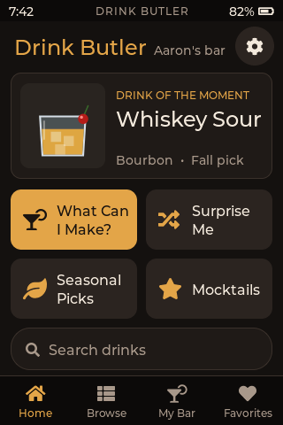

# Desktop simulator

Runs the real UI (`firmware/components/ui`) and data code (`firmware/components/data`) on macOS at the device's 320×480 portrait size, with LVGL 9.4. Clicks and drags with the mouse act as touches.



## Build

You need Xcode command-line tools and CMake (`brew install cmake`). LVGL 9.4, SDL2 2.30 and cJSON are fetched by CMake on the first configure, so the first build takes a few minutes and needs network access.

There are two builds:

| Build | What it is for | SDL |
|---|---|---|
| `simulator/build-headless` | screenshots, touch self-test, scroll benchmark, dataset check. Use this for tests and CI | none linked |
| `simulator/build` | the interactive window | SDL2 compiled from source and linked statically |

```bash
cmake -S simulator -B simulator/build-headless -DADB_SIM_HEADLESS=ON
```

```bash
cmake --build simulator/build-headless -j
```

```bash
cmake -S simulator -B simulator/build
```

```bash
cmake --build simulator/build -j
```

SDL2 is built from source on purpose. Homebrew's `sdl2` package is now `sdl2-compat`, which loads SDL3 at startup, and LVGL 9.4's SDL driver only supports SDL2. Static SDL2 means the binary only depends on macOS system frameworks (`otool -L simulator/build/drink_butler_sim`).

## Run

Interactive window (mouse = touch, scroll wheel scrolls lists):

```bash
./simulator/build/drink_butler_sim
```

Options: `--data path/to/recipes.json`, `--state DIR` (where favorites, pantry and settings are saved; default `~/.drink_butler_sim/`) and `--zoom 2` (bigger window).

The dataset defaults to `data/recipes.json` when it exists, otherwise `docs/research/sample_recipes.json` (10 drinks). `ingredients.json` next to the recipes file is picked up automatically (names, categories, substitutes). Without it, names come from the first recipe's display text and categories are guessed from the ID.

Images: `image.thumb` (96×96) and `image.file` (320×240) are loaded from disk relative to the recipes file (PNG or JPEG). When a file is missing, the UI draws a glass icon from the recipe's glass, colour, ice and garnish. All current screenshots use these icons.

## Headless tools

These modes never open a window:

```bash
./simulator/build-headless/drink_butler_sim --screenshots simulator/screenshots
```

```bash
./simulator/build-headless/drink_butler_sim --selftest
```

```bash
./simulator/build-headless/drink_butler_sim --bench --data data/recipes.json
```

```bash
./simulator/build-headless/drink_butler_sim --check --data data/recipes.json
```

- `--screenshots DIR` drives every screen with a fixed clock (18 Oct, 7:42 pm) and a sample pantry and favorites, then writes PNGs with `lv_snapshot`.
- `--selftest` sends scripted taps through an LVGL pointer input device. It opens a drink, toggles the heart, ticks a bottle in My Bar and flips the sound switch, then checks that the state changed and was saved.
- `--bench` scrolls Browse from top to bottom and renders every 24 px step. It reports how many row objects exist (7 for any list length) and the time per frame on the host CPU.
- `--check` loads a dataset and lists unknown tag values (glass, method, flavor…). It exits with code 3 if there are warnings. The data pipeline can use it as a validation step.
- `--record DIR` plays a scripted tour with the same synthetic touches as the self-test and writes one PNG per frame at 15 fps, with a translucent circle where each touch lands. `DIR/events.txt` records the frame count and when the speaker was tapped. `--speech-ms N` makes the silent speech stand-in last N ms instead of 4 s.

## Demo video

```bash
tools/demo/make_demo.sh
```

This builds the headless simulator, records the tour (Home, Browse scrolling, the filter sheet, the Negroni detail with the speaker playing, My Bar "What can I make?", Favorites, Settings) and writes `build/demo/demo.mp4` (640×960 H.264, 2× nearest-neighbour) and `build/demo/demo.gif` (10 fps, the largest size under 8 MB). `build/` is git-ignored. It takes about half a minute and needs ffmpeg (`brew install ffmpeg`).

When the speech cache has the Negroni clip (`python3 tools/data/build.py pack`, needs opus-tools), the script decodes it with `opusdec`, adds it as the MP4's audio track starting at the speaker tap, and keeps the stop icon on screen for the clip's length. Without the cache the video is silent. `DEMO_CLIP=file.opus` uses another recording, and an argument changes the output folder.

## Unit tests (data component)

```bash
cmake -S firmware/components/data/test -B build/data-test
```

```bash
cmake --build build/data-test && ./build/data-test/adb_data_tests
```

These cover JSON loading, every filter kind and how filters combine, pantry matching (substitutes, optional, water and garnish ignored, missing 1 and 2), persistence round trips, and amount formatting.

## Screenshots

`screenshots/` holds the checkpoint set:

| | |
|---|---|
| 01 Home | 10–12 My Bar results (can make, missing 1, missing 2) |
| 02–03 Browse, with active filter chips | 13 Favorites, 17 empty state |
| 04–05 Filter sheet (tags, ingredients include/exclude) | 14–15 Settings |
| 06 Search with on-screen keyboard | 16 Credits |
| 07–08, 18 Drink detail (oz and ml) | 09 My Bar bottles checklist |

## How it fits the firmware

- `firmware/components/ui` and `firmware/components/data` are ESP-IDF components. Their `CMakeLists.txt` call `idf_component_register` under `ESP_PLATFORM` and otherwise build static libraries for this simulator.
- The UI talks to hardware only through `ui_platform_t` in `ui.h`: battery %, voltage, charging, brightness, sleep timeout, sound on/off, volume, sound effects and the clock. Images go through `ui_image_provider_t`, and persistence through `adb_storage_t` (here: files, on the device: NVS). `sim_platform.c` has the simulator stubs.
- The data loader builds the database through a small builder API (`adb_load.h`), so the device can add a packed-binary loader for the `drinks` partition without touching the UI.
- `lv_conf.h` here is the simulator's. The firmware's LVGL config needs `LV_FONT_CUSTOM_DECLARE`/`LV_FONT_DEFAULT` set to `adb_font_16`, or it can keep its own default font: the UI sets fonts on its root screen and widget styles.
